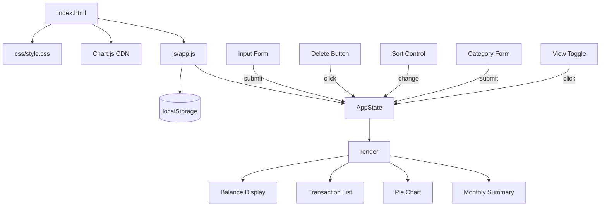

# Design Document

## Overview

The Expense & Budget Visualizer is a zero-dependency, single-page web application delivered as three files: one HTML file at the project root, one CSS file at `css/style.css`, and one JavaScript file at `js/app.js`. It runs entirely in the browser with no build step, no server, and no npm packages; it works when opened with the `file://` protocol in Chrome, Firefox, Edge, and Safari.

The application lets users record personal expense transactions, view a live total balance, explore a category-based pie chart, sort and filter their transaction list, define custom categories, and browse a monthly summary view. All state is persisted to `localStorage`.

**Key design decisions:**

- **No frameworks.** Plain DOM APIs keep the bundle trivial and avoid a build pipeline.
- **Module pattern via IIFE.** A single top-level IIFE wraps `js/app.js` to avoid polluting `window`, while remaining compatible with `file://` (no ES modules, which are blocked by some browsers on `file://`).
- **Event-driven UI updates.** A central `render()` function re-draws every dependent component (balance, chart, list, monthly summary) whenever state changes. This keeps data flow predictable.
- **Chart.js 4 from jsdelivr CDN.** Loaded via a plain `<script>` tag; `chart.umd.min.js` is used so it exposes a global `Chart` and avoids the ESM import problem on `file://`.
- **localStorage as the only persistence layer.** Transactions, custom categories, and the active sort preference are stored as separate JSON keys.

---

## Architecture

### File Structure

```
project-root/
├── index.html          ← single HTML entry point
├── css/
│   └── style.css       ← all styling
└── js/
    └── app.js          ← all application logic
```

### Component Diagram



### Data Flow

```
User Interaction
      │
      ▼
DOM Event Handler
      │  reads
      ▼
  AppState (in-memory)
      │  persists
      ▼
  localStorage
      │
      ▼
  render() ─────────────────────────────────────────────────
      │               │               │               │
      ▼               ▼               ▼               ▼
  Balance        Transaction      Pie Chart      Monthly
  Display           List                         Summary
```

All writes to state go through mutator functions that (1) update the in-memory object, (2) write to `localStorage`, and (3) call `render()`.

---

## Components and Interfaces

### 1. AppState

The single source of truth held in memory for the lifetime of the page.

```js
// In-memory state object (never exposed to window)
const state = {
  transactions: [],   // Transaction[]
  categories: [],     // string[] – custom category names only
  sortOption: 'amount-desc',   // SortOption
  activeView: 'list'  // 'list' | 'monthly'
};
```

### 2. Input Form (`#transaction-form`)

HTML fields:
- `#input-name` — text input (1–100 chars)
- `#input-amount` — number input (0.01–999999999.99, ≤ 2 dp)
- `#input-category` — select populated with built-in options + custom categories
- `#form-error` — `<p>` element for validation messages
- Submit button `#btn-add`

**Behaviour:**
- On submit: validate → if invalid, show error in `#form-error` and return; if valid, call `addTransaction()` then reset form.
- Reset: name → `""`, amount → `""`, category → `"Food"` (first built-in).

### 3. Balance Display (`#balance-display`)

```html
<div id="balance-display">
  <span id="balance-amount">$0.00</span>
</div>
```

Updated by `renderBalance()`. Applies CSS class `balance--negative` when total < 0.

### 4. Transaction List (`#transaction-list`)

```html
<ul id="transaction-list" aria-label="Transactions"></ul>
```

Each item:
```html
<li class="transaction-item" data-id="<uuid>">
  <span class="tx-name">Coffee</span>
  <span class="tx-category">Food</span>
  <span class="tx-amount">$3.50</span>
  <button class="btn-delete" aria-label="Delete transaction">✕</button>
</li>
```

Empty state: `<li class="tx-empty">No transactions recorded yet.</li>`

Rendered by `renderTransactionList()`. Sorted list is computed from `state.transactions` using the active `state.sortOption` before rendering.

### 5. Pie Chart (`#spending-chart`)

```html
<div id="chart-container">
  <canvas id="spending-chart" aria-label="Spending by category"></canvas>
  <p id="chart-empty" hidden>No spending data available.</p>
</div>
```

A single `Chart` instance stored in a closure variable `chartInstance`. On each render:
- If no transactions: destroy chart if exists, show `#chart-empty`.
- If transactions exist: group positive amounts by category → build `labels` and `data` arrays → call `chartInstance.data = …; chartInstance.update()` (or create new instance if none exists).

### 6. Sort Control (`#sort-control`)

```html
<select id="sort-control" aria-label="Sort transactions">
  <option value="amount-desc">Amount: High → Low</option>
  <option value="amount-asc">Amount: Low → High</option>
  <option value="category-asc">Category: A → Z</option>
</select>
```

On `change`: update `state.sortOption`, persist to `localStorage`, call `render()`.

### 7. Custom Category Form (`#category-form`)

```html
<form id="category-form">
  <input id="input-category-name" type="text" maxlength="50" />
  <button type="submit">Add Category</button>
  <p id="category-error"></p>
</form>
```

Validations (in order): non-empty, unique (case-insensitive), ≤ 20 total custom categories.  
On success: append to `state.categories`, persist, re-populate `#input-category` select, clear input.

### 8. Monthly Summary (`#monthly-summary`)

```html
<div id="monthly-summary" hidden>
  <ul id="monthly-list"></ul>
  <p id="monthly-empty" hidden>No transactions available.</p>
</div>
```

Each item: `<li class="month-item [month-item--negative]"><span>January 2025</span><span>$520.00</span></li>`

Computed by `getMonthlyTotals()` → sorted descending by year/month.

### 9. View Toggle (`#btn-toggle-view`)

```html
<button id="btn-toggle-view">View Monthly Summary</button>
```

Toggles `state.activeView` between `'list'` and `'monthly'`. Updates button text and shows/hides `#transaction-list`/`#monthly-summary` sections.

---

## Data Models

### Transaction

```js
/**
 * @typedef {Object} Transaction
 * @property {string} id        - UUID v4 (crypto.randomUUID or Math.random fallback)
 * @property {string} name      - Item name, 1–100 chars
 * @property {number} amount    - Positive number, ≤ 2 decimal places, max 999999999.99
 * @property {string} category  - Category name (built-in or custom)
 * @property {number} timestamp - Date.now() at creation time
 */
```

### localStorage Keys

| Key | Type | Description |
|-----|------|-------------|
| `ebv_transactions` | `Transaction[]` JSON | All stored transactions |
| `ebv_custom_categories` | `string[]` JSON | Custom category names |
| `ebv_sort_option` | `string` JSON | Active sort option value |

The prefix `ebv_` avoids collisions with other apps on the same origin.

### Sort Options

```js
// SortOption type
// 'amount-desc'   → by amount descending, tiebreaker: timestamp descending
// 'amount-asc'    → by amount ascending,  tiebreaker: timestamp descending
// 'category-asc'  → by category name A→Z, tiebreaker: timestamp descending
```

### Built-in Categories

```js
const BUILTIN_CATEGORIES = ['Food', 'Transport', 'Fun'];
const MAX_CUSTOM_CATEGORIES = 20;
const AMOUNT_MAX = 999_999_999.99;
```

---

## Correctness Properties

*A property is a characteristic or behavior that should hold true across all valid executions of a system — essentially, a formal statement about what the system should do. Properties serve as the bridge between human-readable specifications and machine-verifiable correctness guarantees.*

### Property 1: Transaction addition grows the list

*For any* existing transaction list and a valid transaction (non-empty name 1–100 chars, amount between 0.01 and 999999999.99 with at most 2 decimal places, non-empty category), adding that transaction SHALL result in the transaction list length increasing by exactly one and the new transaction being present in the list.

**Validates: Requirements 1.3**

### Property 2: Whitespace and invalid amounts are rejected

*For any* form submission where the item name is empty or composed entirely of whitespace, OR the amount is zero, negative, non-numeric, greater than 999999999.99, or has more than 2 decimal places, the transaction list SHALL remain unchanged (same length and same contents) after the attempted submission.

**Validates: Requirements 1.4, 1.5**

### Property 3: Transaction persistence round-trip

*For any* transaction added to the app, serializing the transaction list to `localStorage` and then reading it back SHALL produce a list containing a transaction with equal `id`, `name`, `amount`, `category`, and `timestamp` fields.

**Validates: Requirements 5.1, 5.2**

### Property 4: Balance equals sum of amounts

*For any* transaction list (including empty), the value shown in the Balance Display SHALL equal the arithmetic sum of all `amount` fields in the list, formatted with a currency symbol and exactly two decimal places.

**Validates: Requirements 3.1, 3.4**

### Property 5: Delete removes exactly one transaction

*For any* transaction list and any transaction in that list, deleting that transaction SHALL result in a list of length exactly one less, and the deleted transaction's `id` SHALL no longer appear in the list.

**Validates: Requirements 2.3**

### Property 6: Sort stability and correctness

*For any* transaction list and any valid sort option, the sorted list SHALL contain exactly the same transactions as the original (no additions or deletions), and every adjacent pair SHALL satisfy the sort comparator (primary key, then timestamp descending as tiebreaker).

**Validates: Requirements 8.1, 8.2**

### Property 7: Custom category uniqueness

*For any* existing category list (built-in + custom), attempting to add a name that matches any existing category name (case-insensitive) SHALL leave the category list unchanged.

**Validates: Requirements 6.4**

### Property 8: Custom category persistence round-trip

*For any* list of custom category names saved to `localStorage`, reloading the app SHALL restore a category select that contains all and only those custom category names (plus the built-in ones).

**Validates: Requirements 6.6**

### Property 9: Monthly summary totals correctness

*For any* transaction list, for each calendar month present in the list, the monthly total shown in the Monthly Summary SHALL equal the sum of the `amount` fields of all transactions whose timestamp falls within that calendar month.

**Validates: Requirements 7.2**

### Property 10: Corrupt localStorage initialises clean

*For any* string stored under `ebv_transactions` that is not valid JSON or does not conform to the Transaction schema (missing required fields, non-numeric amounts), the app SHALL initialise with an empty transaction list and display the data-load error message.

**Validates: Requirements 5.3**

---

## Error Handling

| Scenario | Detection | Recovery |
|----------|-----------|----------|
| `localStorage` write failure (quota exceeded, private mode) | Wrap every `localStorage.setItem` in a `try/catch` | Display an error banner `#storage-error`; continue with in-memory state |
| `localStorage` read returns corrupt JSON | `try/catch` around `JSON.parse` on init | Discard key, initialise empty, show `#load-error` message |
| Transaction schema violation on load (missing fields, bad types) | Validate each parsed object against required fields before adding to state | Discard invalid records, show `#load-error` message |
| `localStorage.getItem` returns `null` for sort option | Check for `null` before JSON.parse | Silently default to `'amount-desc'`; no error shown (Requirement 8.5) |
| `localStorage` unavailable for custom categories | Wrap `setItem`/`getItem` in `try/catch` | Show `#category-storage-error`; operate with in-memory list only |
| Delete fails to persist | `try/catch` around `localStorage.setItem` after removal | Revert the in-memory removal, re-render list with transaction restored, show `#delete-error` |
| Chart.js CDN fails to load | `window.onerror` or chart canvas `onerror` on the script tag | Hide `#chart-container`, show a static text message "Chart unavailable – chart library could not be loaded." |
| `crypto.randomUUID` unavailable (older browsers) | Feature-detect at ID generation call site | Fallback: `Math.random().toString(36).slice(2) + Date.now().toString(36)` |

All error messages are injected into named, initially-hidden DOM elements (not `alert()`), so the page never blocks.

---

## Testing Strategy

### Overall Approach

This feature is a pure HTML/CSS/Vanilla JS browser app with no build pipeline. Testing targets the pure-logic layer of `js/app.js` using **property-based tests** for universal invariants and **unit tests** for specific examples and edge cases.

Property-based testing is applicable here because the core business logic — transaction validation, sorting, balance calculation, monthly grouping, localStorage serialization — consists of pure or near-pure functions whose correctness must hold across a wide input space.

**PBT library:** [fast-check](https://github.com/dubzzz/fast-check) (via CDN or Node test runner). Minimum **100 iterations** per property test.

Each property test references its design document property with a comment:
```js
// Feature: expense-budget-visualizer, Property 1: Transaction addition grows the list
```

### Unit Tests (example-based)

Cover specific scenarios:
- Form renders with correct built-in categories on load
- Empty-state message appears when transaction list is empty
- Balance displays `$0.00` with no transactions
- Pie chart shows empty-state message with no transactions
- Negative balance applies `balance--negative` CSS class
- Monthly summary label format `"Month YYYY"` (e.g., `"January 2025"`)
- Sort control defaults to `amount-desc` when no persisted value
- Delete error reverts the transaction list when `localStorage` fails
- Corrupt localStorage produces the data-load error message on init

### Property-Based Tests

Each property maps to a correctness property in the design:

| Test | Design Property | fast-check Arbitraries |
|------|----------------|----------------------|
| Adding a valid transaction grows list by 1 | Property 1 | `fc.record({ name: fc.string({minLength:1, maxLength:100}).filter(s=>s.trim()!==''), amount: fc.float({min:0.01, max:999999999.99}), category: fc.constantFrom(...categories) })` |
| Invalid inputs leave list unchanged | Property 2 | `fc.oneof(fc.constant(''), fc.string().map(s=>' '.repeat(s.length+1)), ...)` |
| Transaction serialization round-trip | Property 3 | `fc.array(validTransactionArb)` |
| Balance equals arithmetic sum | Property 4 | `fc.array(validTransactionArb)` |
| Delete removes exactly one transaction | Property 5 | `fc.array(validTransactionArb, {minLength:1})` → pick random index |
| Sort produces valid order | Property 6 | `fc.array(validTransactionArb)` × `fc.constantFrom('amount-desc','amount-asc','category-asc')` |
| Custom category uniqueness | Property 7 | `fc.array(fc.string({minLength:1,maxLength:50}))` with case variation |
| Custom category round-trip | Property 8 | `fc.array(fc.string({minLength:1,maxLength:50}), {maxLength:20})` |
| Monthly totals correctness | Property 9 | `fc.array(validTransactionArb)` |
| Corrupt data initialises clean | Property 10 | `fc.oneof(fc.string(), fc.jsonValue().filter(v=>!isValidSchema(v)))` |

### Integration / Smoke Tests

Run manually in browser (or Playwright/Puppeteer if added later):
- Open `index.html` via `file://` in each target browser; verify no console errors
- Full add → verify → delete flow persists and clears correctly
- Page reload preserves transactions, categories, and sort preference
- Chart renders after first transaction is added
- Chart.js CDN script loads without errors

### Accessibility

- All interactive controls have accessible labels (`aria-label`, `<label for>`, or `role`)
- Error messages are injected into live regions (`aria-live="polite"`) where feasible
- Colour contrast meets WCAG 2.1 AA for text (note: full validation requires manual assistive technology testing)
